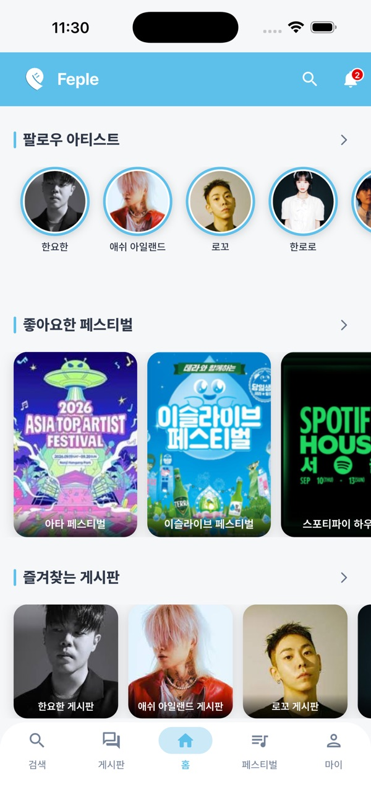
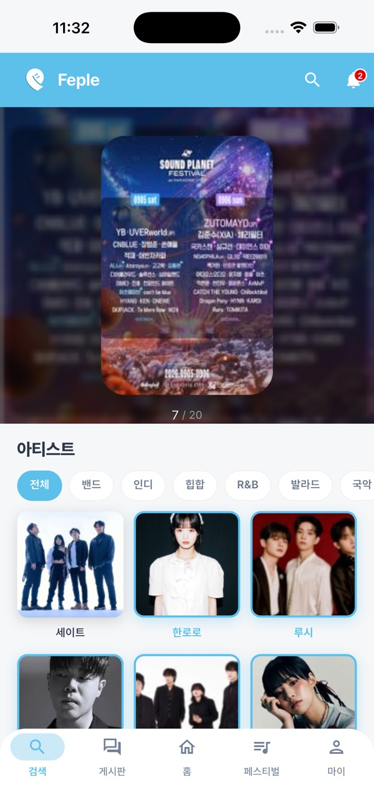
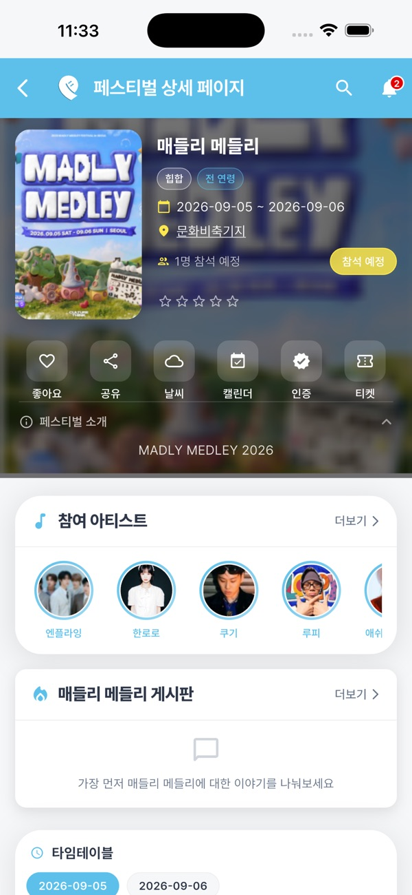
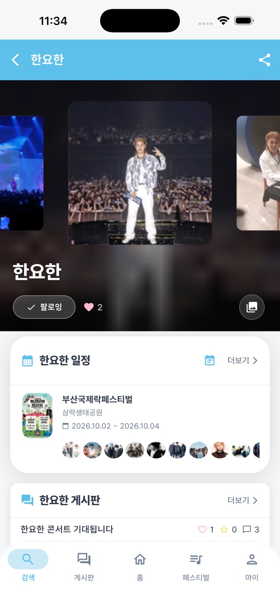
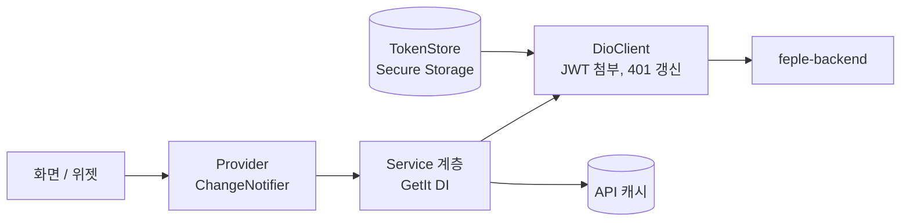

# FEPLE Frontend

페스티벌 정보와 라인업을 보고 팬끼리 소통하는 커뮤니티 앱 **FEPLE**의 Flutter 클라이언트입니다.

**다운로드** [App Store](https://apps.apple.com/kr/app/feple/id6804336803) · [Google Play](https://play.google.com/store/apps/details?id=com.dobino.feple)

**서버 코드** [feple-backend](https://github.com/yangjaehoon/feple-backend)

| 홈 | 탐색 | 페스티벌 상세 | 아티스트 |
|:---:|:---:|:---:|:---:|
|  |  |  |  |

## 핵심 문제 해결

| 문제 | 원인과 해결 | 근거 |
|------|------|------|
| 로그인 사용자가 앱을 새로 실행하면 게스트 탭으로 진입하고 알림 개수가 비어 있음 | 위젯 트리가 자동 로그인보다 먼저 빌드돼 게스트 기준 초기값이 고정됨. 인증 전환을 양방향으로 처리하고, 사용자가 직접 고른 탭은 유지 | [PR #70](https://github.com/yangjaehoon/feple-frontend/pull/70) |
| 응답 없는 네트워크에서 최대 40초 동안 스플래시만 표시 | 자동 로그인의 네트워크 갱신까지 기다린 것이 원인. 캐시로 사용자를 확정하면 바로 진입하고, 갱신은 백그라운드로 분리 | [PR #76](https://github.com/yangjaehoon/feple-frontend/pull/76) |
| 온보딩에서 페스티벌 일괄 등록이 간헐적으로 실패 | 전체 병렬 요청이 서버의 DB 데드락 조건을 만듦. 3개씩 묶어 요청하고 서버 쪽 토글과 함께 수정 | [수정 커밋](https://github.com/yangjaehoon/feple-frontend/commit/10553f8) |

## 아키텍처



## 기술 스택

| 분류 | 기술 |
|------|------|
| 프레임워크 | Flutter 3.44 (Android / iOS) |
| 상태관리 / DI | Provider, GetIt |
| 네트워크 | Dio, Connectivity Plus |
| 인증 | Firebase Auth, Kakao SDK, Sign in with Apple |
| 알림 / 모니터링 | Firebase Messaging, Crashlytics, Performance |
| 지도 / 다국어 | Google Maps, Easy Localization |
| 코드 생성 | Freezed, JSON Serializable |

## CI

`push`와 PR마다 GitHub Actions가 `flutter analyze`와 `flutter test`(커버리지 하한선 포함)를 실행하며, 통과해야 `main`에 병합됩니다.

<details>
<summary><strong>주요 기능 전체 보기</strong></summary>

- **페스티벌 탐색** — 목록 조회, 장르·지역 필터링, 상세 정보, 좋아요, 날씨 확인, 평점·리뷰
- **타임테이블** — 공연 시간표 조회 및 스테이지별 일정 확인
- **부스 맵** — 페스티벌 부스 위치 및 카테고리 안내
- **아티스트** — 검색, 팔로우, 공연 일정, 노래 목록(YouTube Music 연결), 사진 갤러리
- **커뮤니티 게시판** — Hot / 자유 / 동행 구하기 게시판, 아티스트·페스티벌 전용 게시판
  - 무한 스크롤 페이지네이션
  - 대댓글(스레드) 지원
  - 좋아요, 스크랩, 신고, 사용자 차단
- **검색** — 아티스트·페스티벌·게시글 통합 검색 (자동완성)
- **페스티벌 인증** — 현장 사진 제출 → 관리자 승인 → 인증 배지 획득
- **노래 요청** — 아티스트 페이지에서 곡 추가 요청, 요청 내역 조회
- **알림** — FCM 푸시 알림, 인앱 알림 목록, 알림별 수신 설정, 전체 읽음 처리
- **마이페이지** — 프로필·닉네임 편집, 팔로우 아티스트, 찜한 페스티벌, 스크랩·작성 글·좋아요한 글·댓글 조회, 인증 내역
- **설정** — 알림 설정, 차단 사용자 관리, 오픈소스 라이선스, 앱 리뷰 유도
- **온보딩** — 최초 실행 시 앱 소개
- **오프라인 대응** — 네트워크 끊김 배너, API 응답 캐시·프리페치
- **다국어** — 한국어 / 영어 지원

</details>

<details>
<summary><strong>프로젝트 구조</strong></summary>

```
lib/
├── auth/                      # TokenStore, 인증 키/시크릿
├── login/                     # 로그인·회원가입·비밀번호 찾기·이메일 인증 화면
├── network/                   # DioClient, API 캐시 스토어, 성능 인터셉터
├── common/
│   ├── theme/                    # AppColors, ThemeColors
│   ├── widget/                    # 공통 위젯 (LoadingButton, ErrorState, BottomSheetHandle 등)
│   ├── util/                      # AppRoute, ConfirmDialog, ImageUploadHelper 등
│   ├── data/preference/           # 로컬 프리퍼런스 저장
│   └── exception/                 # 커스텀 예외 클래스
├── injection.dart             # GetIt DI 등록
├── model/                      # 데이터 모델 (CommentDetail, CertificationModel, FestivalReview 등)
├── provider/                   # 전역 Provider (UserProvider, FestivalPreviewProvider)
├── service/                    # API 서비스 계층
│   ├── artist_service.dart / artist_follow_service.dart / artist_schedule_service.dart / artist_photo_service.dart
│   ├── auth_service.dart / fcm_service.dart / fcm_token_service.dart
│   ├── certification_service.dart
│   ├── comment_service.dart / post_service.dart / report_service.dart / block_service.dart / scrap_service.dart
│   ├── festival_service.dart / festival_detail_service.dart / festival_interaction_service.dart / festival_cache_service.dart
│   ├── notification_service.dart / notification_preference_service.dart
│   ├── search_service.dart
│   ├── song_service.dart / song_request_service.dart
│   ├── user_service.dart / user_activity_service.dart
│   ├── app_review_service.dart / cache_prefetch_service.dart
│   └── ...
└── screen/
    ├── main/tab/
    │   ├── home/                  # 홈 (즐겨찾기 게시판, 팔로우 아티스트, 추천 페스티벌)
    │   ├── festival_list/         # 페스티벌 목록·상세·타임테이블·부스 맵
    │   ├── community_board/       # 커뮤니티 게시판·게시글 상세·댓글
    │   ├── search/                # 통합 검색
    │   └── my_page/               # 마이페이지 (프로필, 인증, 스크랩, 노래 요청 등)
    ├── notification/              # 알림 목록
    ├── settings/                  # 알림 설정, 차단 사용자 관리
    ├── opensource/                 # 오픈소스 라이선스
    └── onboarding/                 # 온보딩
```

</details>

<details>
<summary><strong>로컬 실행 방법</strong></summary>

필수 파일 (git 미추적):

| 파일 | 용도 |
|------|------|
| `android/app/google-services.json` | Firebase Android 설정 |
| `ios/Runner/GoogleService-Info.plist` | Firebase iOS 설정 |
| `lib/auth/secrets.json` | Kakao REST API 키 등 |

`web/index.html` 내 Google Maps API 키도 로컬에서 직접 입력합니다.

```bash
flutter pub get
flutter analyze         # 정적 분석
flutter run             # 개발 실행

# 배포 빌드
flutter build appbundle --release   # Play Store (AAB)
flutter build ipa --release         # App Store
```

</details>
